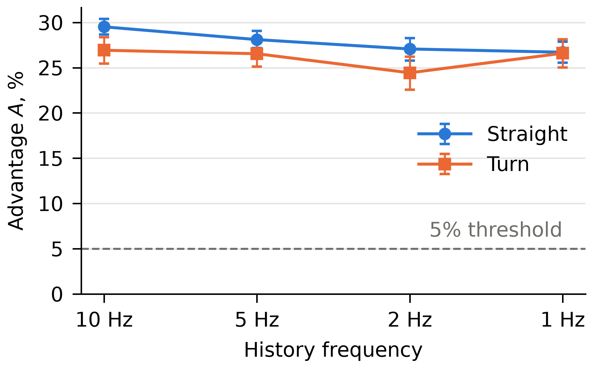

# Learned versus kinematic trajectory prediction under reduced observation frequency

Code, configuration and per-scenario results for the paper of the same name.

- Paper: submitted to Periodica Polytechnica Transportation Engineering (under review)
- Preprint: arXiv link will be added here

## Question

A trajectory predictor sees the past positions of a road user and forecasts the next 6 s. In vehicle-to-everything (V2X) communication these positions may arrive less often than the 10 Hz of common datasets. We train an LSTM on the history of the focal agent of Argoverse 2 at 10, 5, 2 and 1 Hz and compare it with constant velocity (CV) and constant acceleration (CA) models. No maps and no neighbouring agents are used.

- RQ1: How does the LSTM error change as the history frequency drops from 10 to 1 Hz?
- RQ2: At which frequency does the LSTM lose its advantage over the kinematic models, on straight and turning trajectories?
- RQ3: Can a model trained at 10 Hz be used on sparse inputs without retraining?

## Hypotheses

The hypotheses, thresholds and statistical plan were fixed in [PLAN.md](PLAN.md) before the main runs (tags `protocol-v1` to `protocol-v4`). A change of 5% counts as negligible.

- H1: from 10 to 5 Hz the LSTM ADE grows by at most 5%, at 1 Hz by more than 20%.
- H2: at 2 and 1 Hz the LSTM advantage over the better of CV and CA is below 5% on straight trajectories and above 5% on turns.
- H3: at 2 and 1 Hz the 10 Hz model with linearly interpolated input is worse than the model trained at that frequency by more than 5%.

## Results

Official Argoverse 2 test split, 24,984 scenarios, main mode (all points of the 5 s history). ADE in meters, mean over scenarios and seeds, 95% bootstrap intervals over scenarios and seeds. Source: [results/tables/table_main.csv](results/tables/table_main.csv).

| Model | 10 Hz | 5 Hz | 2 Hz | 1 Hz |
|---|---|---|---|---|
| CV | 4.40 [4.35, 4.44] | 4.47 [4.42, 4.52] | 4.71 [4.66, 4.75] | 5.09 [5.04, 5.14] |
| CA | 10.24 [9.96, 10.51] | 8.05 [7.89, 8.21] | 6.68 [6.57, 6.79] | 5.98 [5.90, 6.06] |
| LSTM trained at each frequency | 3.11 [3.08, 3.15] | 3.21 [3.17, 3.25] | 3.43 [3.37, 3.49] | 3.75 [3.69, 3.80] |
| LSTM trained at 10 Hz, linear interpolation | | 3.12 [3.09, 3.16] | 3.47 [3.43, 3.52] | 4.18 [4.12, 4.23] |

The 8 primary comparisons use Bonferroni-corrected 99.4% intervals. Source: [results/primary_comparisons.csv](results/primary_comparisons.csv).

| Hypothesis | Comparison | Estimate, % | 99.4% interval, % | Result |
|---|---|---|---|---|
| H1 | ADE growth 10 to 5 Hz, below 5% | 3.1 | [2.2, 4.2] | supported |
| H1 | ADE growth 10 to 1 Hz, above 20% | 20.3 | [18.4, 22.3] | inconclusive |
| H2 | advantage at 2 Hz, straight, below 5% | 27.1 | [25.2, 28.7] | contradicted |
| H2 | advantage at 1 Hz, straight, below 5% | 26.7 | [25.1, 28.2] | contradicted |
| H2 | advantage at 2 Hz, turn, above 5% | 24.4 | [21.7, 26.9] | supported |
| H2 | advantage at 1 Hz, turn, above 5% | 26.6 | [24.3, 28.7] | supported |
| H3 | 10 Hz model penalty at 2 Hz, above 5% | 1.3 | [-1.0, 3.4] | contradicted |
| H3 | 10 Hz model penalty at 1 Hz, above 5% | 11.5 | [9.5, 13.6] | supported |

Each hypothesis is partly supported. The lowest frequency with an LSTM ADE growth below 5% at every higher tested frequency is 5 Hz ([results/min_sufficient_freq.csv](results/min_sufficient_freq.csv)). This holds for our frequency grid, model and data only.



## Repository

- `PLAN.md` pre-registered plan with the list of changes between versions
- `configs/` training settings (`train.yaml`) and the scenario id lists of train, validation and test
- `src/` all scripts, run from the repository root
- `results/` per-scenario errors of every model and seed (`kinematic_errors.parquet`, `rnn_errors.parquet`), training logs (`runs/`), statistics and tables
- `figures/` figures of the analysis, the paper figure (`journal/`) and the quality check of motion groups (`qc/`)

The dataset and the model weights are not in the repository. Weights are available from the authors on request.

## Reproducing

Tested on Windows, Python 3.11.5, CPU only.

```
python -m venv venv
venv\Scripts\activate
pip install -r requirements.txt
```

On Linux or macOS activate with `source venv/bin/activate`.

### From the repository alone

These scripts need only the files in the repository. We ran them from a fresh clone, and all outputs matched the committed files byte for byte.

```
python src/check_results.py
python src/summarize_runs.py
python src/stats.py
python src/paper_figures.py
```

- `check_results.py` checks that every planned model, frequency, seed and test scenario is present, that input scaling and heading changes are finite and that the 8 primary comparisons match the plan.
- `summarize_runs.py` selects the hyperparameters from the training logs and applies the rule for seeds 6 to 10.
- `stats.py` runs the bootstrap (10,000 resamples, seed 2026), the 8 primary comparisons, the minimum sufficient frequency and the threshold sensitivity check, and writes the tables and figures. It takes about 1.5 minutes.
- `paper_figures.py` draws the paper figure from `results/stats_summary.csv`.

### From the dataset

The remaining steps need Argoverse 2 Motion Forecasting, which we do not redistribute. Download uses [s5cmd](https://github.com/peak/s5cmd).

```
python src/download_subset.py path\to\s5cmd.exe
s5cmd --no-sign-request run download_train.txt
s5cmd --no-sign-request cp --exclude "*.json" "s3://argoverse/datasets/av2/motion-forecasting/test/*" data/test/
s5cmd --no-sign-request cp "s3://argoverse/datasets/av2/motion-forecasting/av2_mf_focal_test_annotations.parquet" data/
```

`download_subset.py` draws 60,000 training scenarios with seed 42. The drawn list is committed in `configs/train_subset.txt`, so the same scenarios can be downloaded even if the bucket listing changes. Maps are not downloaded. The test annotations were downloaded on 2026-10-26.

```
python src/prepare_data.py
python src/describe_data.py
python src/kinematic.py
python src/save_angles.py
python src/qc_zoom.py
python src/cv_mean_velocity.py
```

`prepare_data.py` keeps scenarios where the focal agent is observed at all 110 steps (no scenario was excluded), splits train into 50,000 train and 5,000 validation scenarios and writes `data/processed/`. The other scripts compute group statistics, CV and CA errors, motion angles, the quality check and the comparison of two CV velocity estimates.

### Training and evaluation

Grid search with seed 0, then the selected settings with seeds 1 to 10 (main mode) and 1 to 3 (additional mode, 10, 5 and 2 Hz). `summarize_runs.py` prints the commands with the selected settings.

```
foreach ($f in 10, 5, 2, 1) { foreach ($h in 64, 128) { foreach ($lr in 0.001, 0.0003) { python src/train.py --freq $f --hidden $h --lr $lr --seed 0 } } }
python src/summarize_runs.py
python src/evaluate.py
```

The 65 runs in `results/runs/` took about 4 hours of training on a CPU in total. Training uses fixed seeds and deterministic PyTorch algorithms, but results on other hardware or library versions may differ slightly from the committed logs.

## Data and license

Code: MIT, see [LICENSE](LICENSE).

Argoverse 2 is distributed under CC BY-NC-SA 4.0 and the Argoverse terms of use. The per-scenario results in `results/` are derived from it and are shared under the same terms.

## Citation

Will be added after the preprint is published.